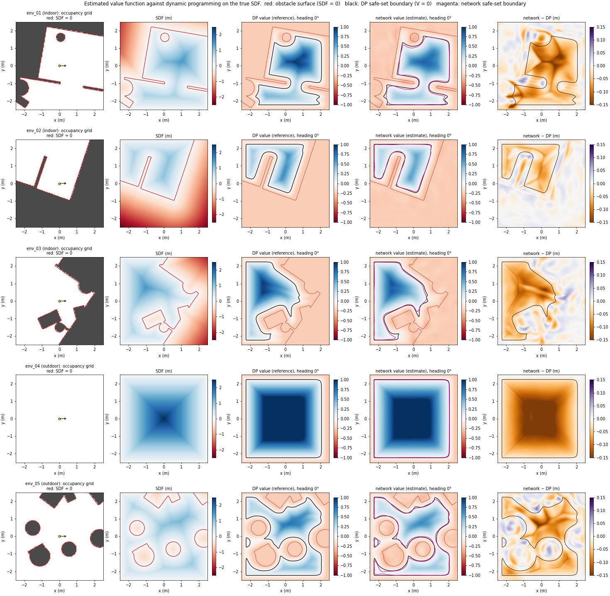

# Deliverable 1: latent-conditioned safety value function for local static environments

Two trained models that together estimate a Hamilton–Jacobi (HJ) safety value function from a local signed
distance field (SDF), five example environments with dynamic-programming (DP) reference solutions, and a script
that runs the models on the examples and plots the comparison.

```
SDF window (100 x 100)  --VAE encoder-->  latent z (64 numbers)  --value network + query state (x, y, theta)-->  V, dV/dstate
```

`V > 0` means: from this state the robot can stay collision-free (and inside the 5 m window) for the next 6 s,
whatever a bounded disturbance does.

## Contents

| Path | What it is |
|---|---|
| `models/sdf_vae_latent64_penalty.pt` | SDF VAE, latent size 64, trained with the over-estimate penalty (56 MB) |
| `models/value_net_16000env.pt` | Value network trained on 16,000 environments (3.3 MB) |
| `adaptivesf_models/` | Python package to load and use the models (`sdf_vae.py`, `value_net.py`, helpers in `__init__.py`) |
| `examples/env_01.npz` … `env_05.npz` | Five test environments (3 indoor, 2 outdoor): occupancy grid, SDF, DP value functions |
| `run_example.py` | Runs the models on the examples, prints metrics, writes the comparison plot |
| `expected_output/` | The plot and metrics the script produced when this folder was made |
| `requirements.txt` | `torch`, `numpy`, `matplotlib` |

## Quick start

```bash
pip install -r requirements.txt          # any recent PyTorch; a GPU is not needed
python run_example.py                    # about 10 s on CPU; writes output/
```

Expected terminal output (CPU; numbers may differ in the last digit):

```
environment      reference                     value err  boundary err  false-safe  false-unsafe
env_01 (indoor)  DP on the true SDF               4.80 cm       3.16 cm      0.03 %        2.65 %
env_01 (indoor)  DP on the decoded SDF            1.44 cm       1.24 cm      0.26 %        0.91 %
env_02 (indoor)  DP on the true SDF               2.84 cm       1.81 cm      0.05 %        1.09 %
env_02 (indoor)  DP on the decoded SDF            1.16 cm       1.00 cm      0.50 %        0.30 %
env_03 (indoor)  DP on the true SDF               4.84 cm       3.07 cm      0.05 %        2.50 %
env_03 (indoor)  DP on the decoded SDF            1.18 cm       1.09 cm      0.51 %        0.53 %
env_04 (outdoor) DP on the true SDF               7.82 cm       1.81 cm      0.00 %        1.29 %
env_04 (outdoor) DP on the decoded SDF            0.30 cm       0.26 cm      0.12 %        0.39 %
env_05 (outdoor) DP on the true SDF               3.50 cm       2.47 cm      0.17 %        3.75 %
env_05 (outdoor) DP on the decoded SDF            1.45 cm       1.42 cm      0.91 %        1.53 %

mean over the 5 examples, against DP on the true SDF:    value error 4.76 cm, boundary error 2.46 cm, false-safe 0.06 %
mean over the 5 examples, against DP on the decoded SDF: value error 1.11 cm, boundary error 1.00 cm, false-safe 0.46 %
```

and the figure `output/comparison_heading_000deg.png` (a copy is in `expected_output/`):



## 1. Model information

### 1.1 Conventions shared by both models

| Item | Convention |
|---|---|
| Window | 5 m × 5 m square centred on the ego robot at the sensing instant; 100 × 100 cells of 0.05 m; values at the cell centres, −2.475 … +2.475 m (`adaptivesf_models.window_axis()`) |
| Frame | Origin at the ego, **+x along the ego heading**. The window stays fixed while the value function is queried; a query state is (x [m], y [m], θ [rad]) in this frame, so the ego itself is at (0, 0, 0) |
| Arrays | Indexed `[ix, iy]` (first axis is x). To display with x horizontal and y up: `imshow(a.T, origin="lower")` |
| SDF | Metres, **positive in free space, negative inside obstacles** |
| Closed border | **Everything outside the window counts as an obstacle.** The SDF must therefore also measure the distance to the window border (it is about 0.025 m on the outermost cells). See 2.3 for how to build such an SDF from an occupancy grid |
| Robot | Disc of radius r = 0.25 m. Do **not** inflate the obstacles in the SDF; the radius is already part of the value function |

### 1.2 SDF VAE: `models/sdf_vae_latent64_penalty.pt`

| | |
|---|---|
| Purpose | Compress an SDF window into a 64-number latent (and decode it back) |
| Input | `[B, 1, 100, 100]` float32, SDF in metres clipped to **[−1, +2] m** |
| Output of `encode` | `[B, 64]` latent mean. This is what the value network takes |
| Output of `decode` | `[B, 1, 100, 100]` reconstructed SDF in metres |
| Architecture | ResNet encoder (7×7 conv, max-pool, 4 residual stages 64→512 channels, 2×2 average pool, linear heads); decoder with 4 residual transposed-conv stages and a bilinear resize. 14.0 M parameters (encoder 9.8 M). Batch norm and dropout: **use `eval()` mode** (the loader does this) |
| Training data | 111,372 windows: indoor floor plans (HouseExpo) with 0–4 added discs/boxes, and outdoor fields of random discs and boxes |
| Training loss | Squared error weighted towards 0 ≤ SDF ≤ 0.25 m, KL term, and a **3× penalty where the reconstruction over-estimates clearance**, so decoded obstacles tend to be slightly too large rather than too small |
| Accuracy (64,848 unseen test windows) | At the level set SDF = 0.25 m: boundary error 2.8 cm; 0.04 % of cells decoded as free when they are not; 2.1 % decoded as not free when they are |

### 1.3 Value network: `models/value_net_16000env.pt`

| | |
|---|---|
| Purpose | Safety value V(x, y, θ; z) for the environment encoded by latent z |
| Inputs | `state [N, 3]` = (x, y, θ) in the window frame, and `z [N, 64]` (the same latent repeated for all states of one environment) |
| Output | `V [N]` in metres. `V > 0`: safe for the 6 s horizon. Gradient with respect to the state by automatic differentiation (`value_and_gradient`) |
| Architecture | SIREN MLP: 68 inputs (x/2.5, y/2.5, cos θ, sin θ, 64 standardised latents scaled by 1/30), 3 hidden layers of 512 with sin(30·) activations, linear output. 0.82 M parameters. Normalisation constants are stored in the checkpoint |
| What V means | V(state) = max over controls, min over disturbances, of the smallest value of (SDF − 0.25 m) along the trajectory over **T = 6 s, no discount** |
| Robot model | 3D Dubins car: dx/dt = v cos θ + d_x, dy/dt = v sin θ + d_y, dθ/dt = ω + d_θ, with v ∈ [0, 1] m/s, ω ∈ [−1, 1] rad/s, and disturbances \|d_x\|, \|d_y\| ≤ 0.1 m/s, \|d_θ\| ≤ 0.1 rad/s |
| Training labels | Grid DP (optimized_dp, second-order scheme) on 100 × 100 × 36 grids, solved on the SDF **decoded by the VAE above** for 16,000 environments; values clipped below at −0.25 m, so inside obstacles the network only says "unsafe" |
| Accuracy (500 unseen test environments, 180 million states) | Against DP on the decoded SDF: value error 1.05 cm, error at the V = 0 boundary 1.03 cm, false-safe 0.57 % of states, false-unsafe 0.55 %. End to end against DP on the true SDF: boundary error 2.48 cm, false-safe 0.09 %, false-unsafe 2.12 % |
| Paired encoder | **Use it only with `sdf_vae_latent64_penalty.pt`.** Latents from another encoder are meaningless to it |

### 1.4 Limits to keep in mind

- The value is an approximation with no formal guarantee. On the test set, subtracting 4.5 cm from the output leaves 1 % of states over-predicted with respect to DP on the decoded SDF (2.6 cm for 5 %).
- It is valid for the robot model, bounds, radius, horizon and window defined above. Other dynamics or radii need new labels and retraining.
- It was trained on HouseExpo-style floor plans and random disc/box fields. Thin walls (about 10 cm) are the weak point of the VAE.
- Values below about −0.25 m carry no information (labels were clipped there).
- The SDFs used in training were computed from a 1 cm rasterisation. An SDF computed directly from a 5 cm occupancy grid, as in 2.3, is slightly coarser: on the five examples it differs from the stored SDF by about 1 cm on average and up to 4 cm, and the resulting value estimates are essentially the same (false-safe below 0.15 %).

## 2. Using the models

### 2.1 The example data

Each `examples/env_XX.npz` contains:

| Key | Shape, type | Meaning |
|---|---|---|
| `occupancy` | 100 × 100, bool | Occupancy grid, `True` = occupied, `[ix, iy]` |
| `sdf` | 100 × 100, float32 | SDF in metres with the closed border included (computed from the underlying geometry at 1 cm resolution) |
| `value_dp` | 100 × 100 × 36, float32 | DP value function on this SDF (the ground truth for the environment), `[ix, iy, itheta]`, clipped below at −0.25 |
| `value_dp_decoded` | 100 × 100 × 36, float32 | DP value function on the SDF decoded by the VAE from this environment's latent (what the network was trained to reproduce) |
| `x`, `y` | 100, float32 | Cell-centre coordinates in metres |
| `theta` | 36, float32 | Headings in rad: −π + k·10° |
| `kind` | string | `indoor` or `outdoor` |

The five environments are test environments: neither model saw them, or anything from the same houses, during training.

### 2.2 Estimating the value function of an example

```python
import numpy as np
import adaptivesf_models as am

vae = am.load_vae()                      # device="cuda:0" for GPU
net = am.load_value_net()

ex = np.load("examples/env_01.npz")
z = am.encode_sdf(vae, ex["sdf"])        # tensor [1, 64]
V = am.value_on_grid(net, z)             # numpy [100, 100, 36], metres; same grid as ex["value_dp"]

safe = V > 0                             # estimated safe set
err = np.abs(V - ex["value_dp"])[ex["value_dp"] > -0.249].mean()     # mean error against DP, metres

# value and gradient at arbitrary states (x, y, theta) in the window frame
v, grad = am.value_and_gradient(net, z, [[0.0, 0.0, 0.0], [1.0, -0.5, 1.57]])
# v: [2] metres; grad: [2, 3] = dV/dx, dV/dy (dimensionless), dV/dtheta (m/rad)
```

`run_example.py` does exactly this for all five examples, computes the metrics below against both DP references,
and draws one row per environment: occupancy grid with SDF = 0, the SDF, the DP value, the network value, and
their difference, for one heading (`--heading-deg`, default 0).

```bash
python run_example.py --heading-deg 90 --device cuda:0 --out my_output
```

Metrics printed by the script:

| Metric | Definition |
|---|---|
| value err | mean \|V_network − V_DP\| over states where the DP value is not clipped |
| boundary err | the same over states with \|V_DP\| < 5 cm, i.e. near the safe-set boundary |
| false-safe | share of all states with V_network > 0 while V_DP ≤ 0 (the unsafe direction) |
| false-unsafe | share of all states with V_network ≤ 0 while V_DP > 0 (the cautious direction) |

How to read the two references:

- **DP on the decoded SDF** isolates the value network: this is the function it was trained to reproduce, and the error is about 1 cm.
- **DP on the true SDF** is the end-to-end result and includes the VAE's reconstruction error. It is larger (3 to 8 cm in value, 2 to 3 cm at the boundary) but almost entirely on the cautious side: false-safe stays below 0.2 % on the examples. In the open centre of free areas the estimate is lower than DP (orange in the difference panel; clearest in `env_04`) because the VAE was trained on SDFs clipped at 2 m and flattens the peak; this does not move the safe-set boundary.

### 2.3 Using your own environment

Build the SDF in the conventions of 1.1. From a 100 × 100 boolean occupancy grid in the ego frame:

```python
import numpy as np
from scipy.ndimage import distance_transform_edt

def sdf_from_occupancy(occ, cell=0.05):
    """occ[ix, iy] = True where occupied. Returns the SDF in metres with the closed window border."""
    o = np.pad(occ, 1, constant_values=True)                 # everything outside the window is occupied
    d_out = distance_transform_edt(~o) * cell
    d_in = distance_transform_edt(o) * cell
    return np.where(o, -(d_in - cell / 2), d_out - cell / 2)[1:-1, 1:-1].astype(np.float32)
```

Then `z = am.encode_sdf(vae, sdf)` and query the value network as above. You can try this on the examples with `sdf_from_occupancy(ex["occupancy"])` in place of `ex["sdf"]`. The ego should not be in collision
(SDF at the centre above 0.25 m), as in the training data.

## 3. Provenance

Models, data and method are described in the project report `AdaptiveSF_V1_V2_report.html`. The files here were
exported from the training runs `runs/v1/half_z64_over3` (VAE) and `runs/v2/n16000` (value network); each `.pt` file
holds `state_dict`, the constructor `config`, and an `info` dictionary with the training settings. The example
environments are rows 16500–16504 of the V2 environment set.
